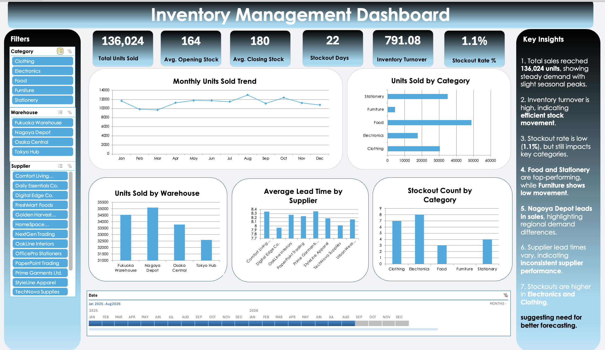

# 📊 Inventory Management Dashboard (Excel)

## 🔹 Project Overview

This project presents a comprehensive **Inventory Management Dashboard** built in Microsoft Excel to analyze stock performance, demand patterns, and supply chain efficiency. The dashboard enables interactive exploration of inventory data and supports data-driven decision-making for optimizing operations.

---

## 🎯 Objective

The goal of this project is to:

* Monitor inventory levels and sales performance
* Identify stockout risks and demand trends
* Evaluate supplier and warehouse efficiency
* Provide actionable insights for inventory optimization

---

## 🧰 Tools & Technologies

* Microsoft Excel
* Pivot Tables & Pivot Charts
* Slicers & Timeline Filters

---

## 📂 Dataset Description

**Data source:** simulated inventory data (2,000 rows) created for practice. All figures and insights below describe this simulated data, not a real company.

The dataset contains the following attributes:

* Date
* Product ID & Product Name
* Category
* Warehouse
* Opening Stock
* Units Received
* Units Sold
* Closing Stock
* Stockout Flag
* Lead Time (Days)
* Supplier
* Unit Cost & Unit Price

---

## 📊 Key Features of Dashboard

* Interactive **KPI Cards** for quick performance overview
* Dynamic filtering using **Slicers (Category, Warehouse, Supplier)**
* **Timeline filter** for time-based analysis
* Multiple visualizations including:

  * Monthly Sales Trend
  * Category-wise Sales Distribution
  * Warehouse Performance
  * Supplier Lead Time Analysis
  * Stockout Analysis

---

## 📈 Key Performance Indicators (KPIs)

* Total Units Sold
* Average Opening & Closing Stock
* Inventory Turnover
* Stockout Rate
* Stockout Days

---

## 🖼️ Dashboard Preview

---

## 🔍 Key Insights

* Total sales reached **136,024 units**, indicating steady demand with seasonal variation
* High inventory turnover reflects **efficient stock utilization**
* Stockout rate is low (**1.1%**), but still impacts key product categories
* **Food and Stationery** are top-performing categories, while **Furniture shows low movement**
* **Nagoya Depot leads in sales**, highlighting regional demand differences
* Supplier lead times vary, indicating **inconsistent supplier performance**
* Higher stockouts in **Electronics and Clothing** suggest need for improved forecasting

---

## 💡 Business Recommendations

* Improve demand forecasting for high-variability categories
* Optimize stock allocation across warehouses
* Reduce dependency on high lead-time suppliers
* Maintain higher safety stock for fast-moving products

---

## 🚀 Key Learnings

* Hands-on experience in building **interactive dashboards in Excel**
* Strong understanding of **inventory and supply chain KPIs**
* Applying business thinking to derive actionable insights

---

## 📌 Conclusion

This project demonstrates the ability to transform raw data into a **meaningful and interactive dashboard**, enabling stakeholders to make informed decisions regarding inventory planning and supply chain optimization.

---

## 👩‍💻 Author

**Saba Zafar**
Data Analyst & Learning Analytics Researcher

* Portfolio: [sabazafar209-wq.github.io/sabazafar.github.io](https://sabazafar209-wq.github.io/sabazafar.github.io/)
* ORCID: [0009-0002-3922-176X](https://orcid.org/0009-0002-3922-176X)
* Email: sabazafar209@gmail.com

---

## 📄 License

Released under the [MIT License](LICENSE).
